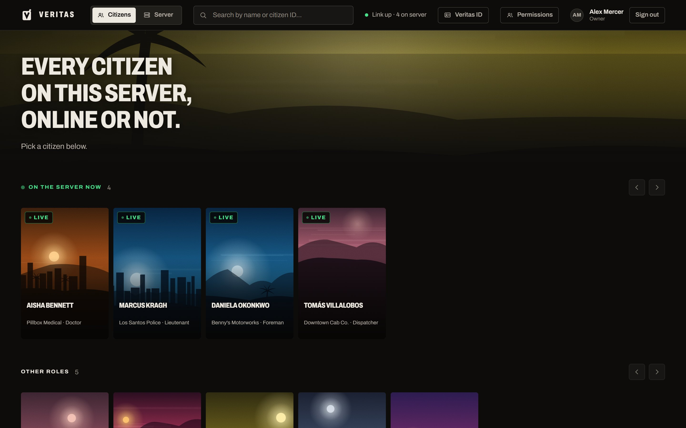
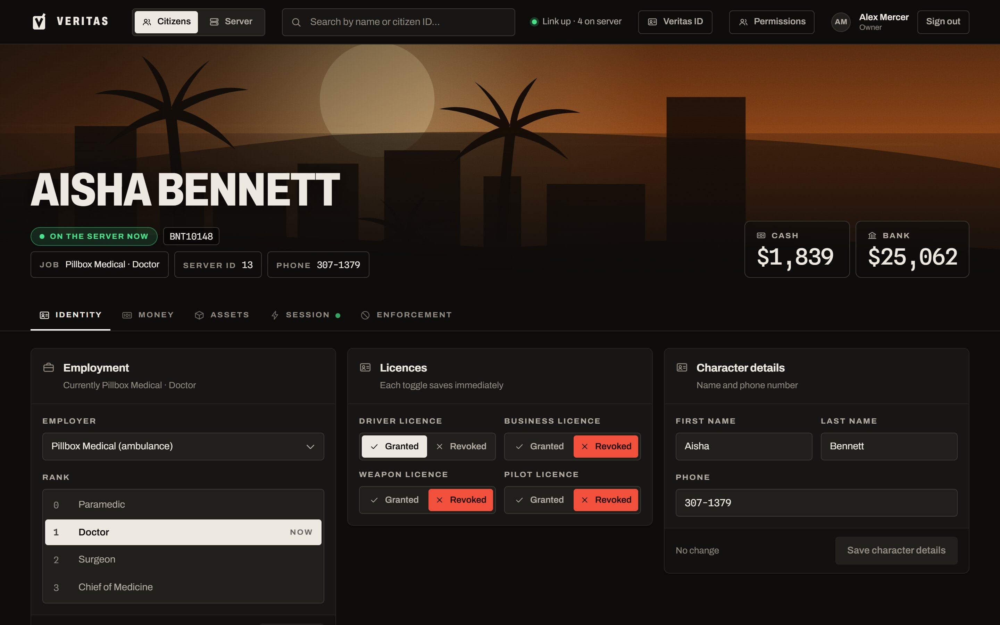
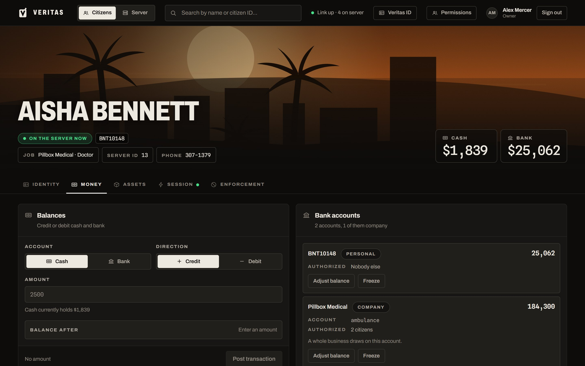
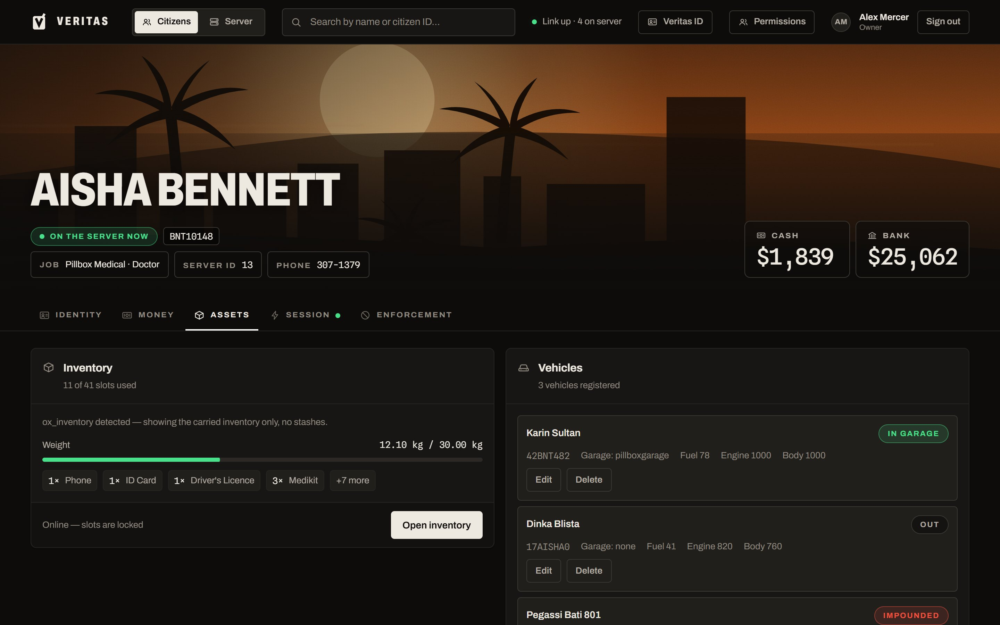
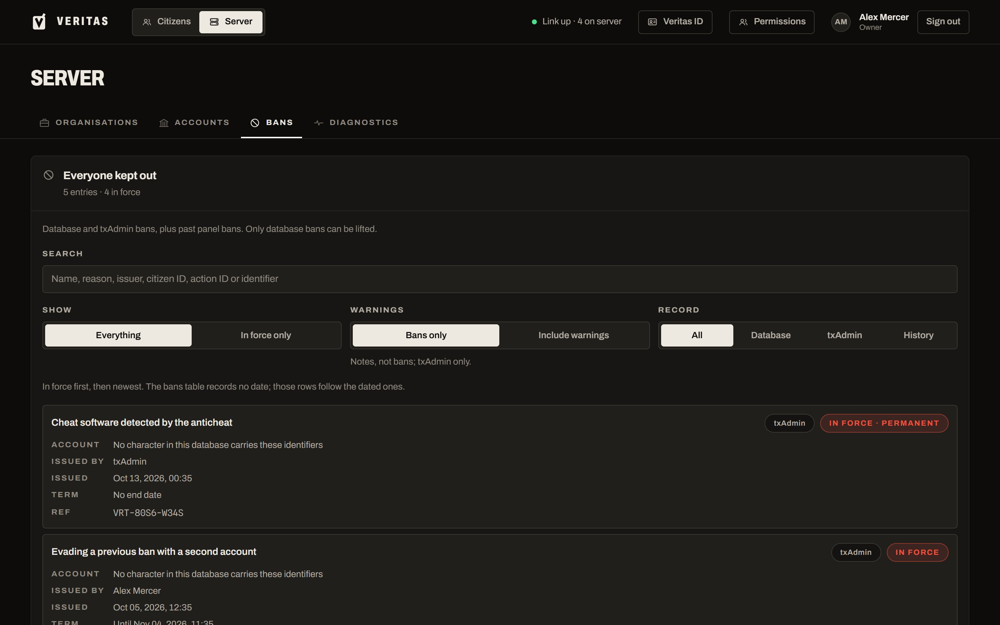
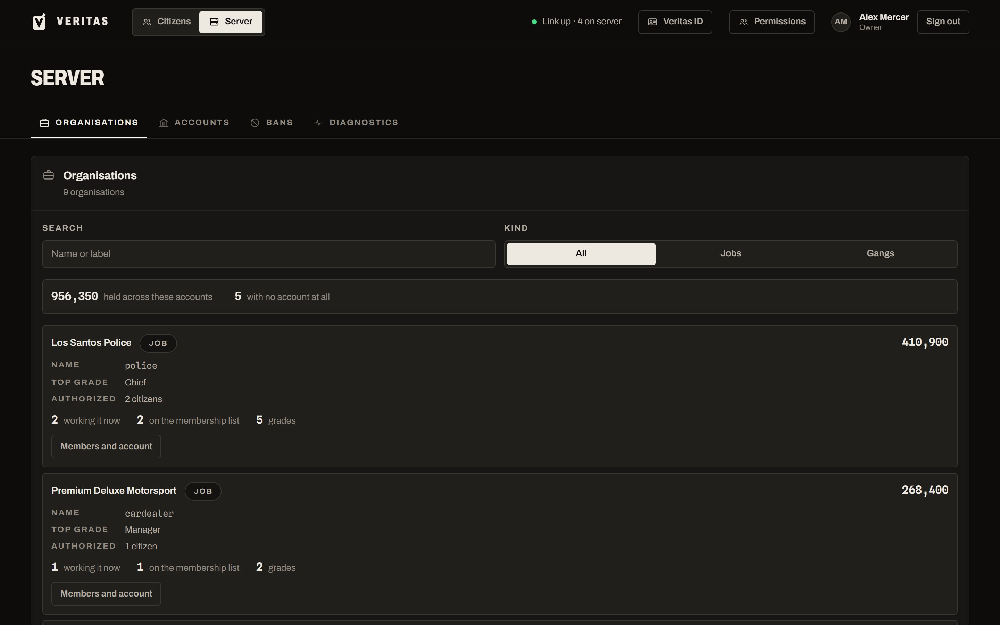
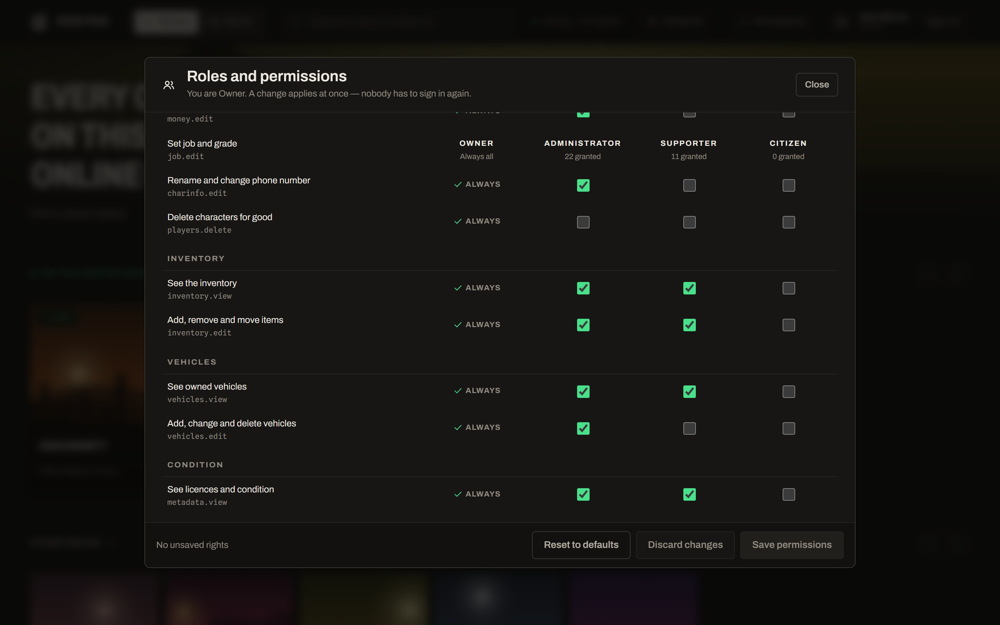
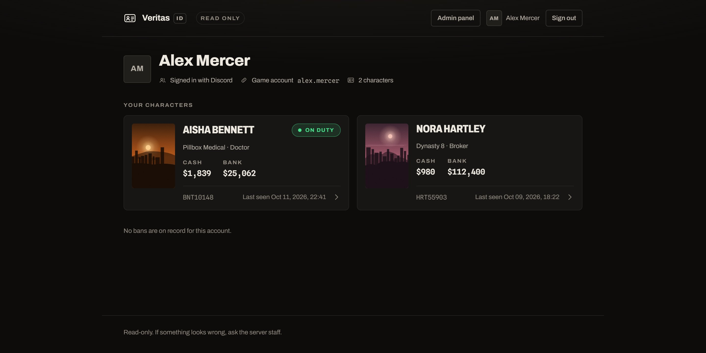
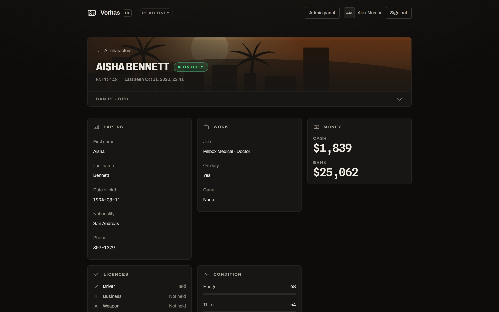

<p align="center">
  
</p>

<p align="center">
  <strong>A web admin panel for FiveM roleplay servers.</strong><br>
  Staff find any character, online or not, and change their job, money, inventory, vehicles, licences or bans from the browser.<br>
  Players get <strong>Veritas ID</strong>, a read-only page where they look up their own characters.
</p>

<p align="center">
  
  
  
  
  
  
</p>

---

## Contents

- [Why it exists](#why-it-exists)
- [A tour](#a-tour)
- [Frameworks](#frameworks)
- [How it is built](#how-it-is-built)
- [Setting it up](#setting-it-up)
- [Updating](#updating)
- [Security](#security)
- [Development](#development)

---

## Why it exists

Most in-game admin menus only reach players who are connected. Editing the database by hand reaches everyone, but a running server holds its own copy of an online player and overwrites the change at the next save.

Veritas does both, and picks per change:

| Citizen | What happens |
|---|---|
| **Online** | The change goes through the `veritas` bridge resource and applies live, in the running session. |
| **Offline** | The change is written straight to their row in the database. |

Every change reports which of the two happened, so staff never have to guess whether a fix landed. The same discipline runs through the rest of the panel: when the bridge cannot be reached, Veritas says the link status is unknown rather than drawing everyone as offline — "not on the server" and "we cannot verify" are different facts.

Typical uses:

- A player lost money or an item to a bug. Find them, credit it back, done, whether they are still in the city or already logged off.
- Promote someone, hand out a licence, or move a car out of the impound before an event.
- See who is banned and why, including txAdmin bans against identifiers that have no character in the database.
- Let players check their own characters, balances, vehicles and ban record without opening a ticket.



---

## A tour

### Citizens

Search by name or citizen ID. Anyone on the server right now sits at the top, and everyone else is grouped by employer. Picking a citizen opens their record in five sections.

| Section | What it holds |
|---|---|
| **Identity** | Job and rank, job and gang memberships, licences, name and phone number. |
| **Money** | Credit or debit cash and bank, and adjust or freeze the bank accounts they can use, company accounts included. |
| **Assets** | The carried inventory, by slot and weight, and owned vehicles with plate, garage, fuel and damage. |
| **Session** | Kick, revive, heal, teleport or message a connected player. Hunger, thirst, stress, armour and jail time are set here too. |
| **Enforcement** | Ban or unban, and the bans already against them. Panel bans keep a history after they are lifted or expire, until someone with the right permission deletes the entry. With its own permission a character can also be deleted for good, through the framework on QBCore and Qbox, and only while its player is offline. |



| Money | Assets |
|---|---|
|  |  |

### Server

Things that belong to the server rather than to one citizen.

- **Organisations** — every job and gang, its members, rank structure and company balance.
- **Accounts** — every bank account on the server, personal and company.
- **Bans** — the game database's `bans` table and txAdmin's own ban record, merged into one searchable list. Each row says where it comes from, and only database bans can be lifted from the panel. Bans issued in Veritas carry a reference a player can quote.
- **Diagnostics** — which framework and schema this installation runs on, and whether the bridge answers.



### Roles and permissions

Staff sign in with Discord. Each person gets a role, either by their Discord account or by a role they hold in your Discord server, and the owner decides in the panel what each role may do. Changes apply immediately, without anyone signing in again.

Owner, Administrator, Supporter and Citizen ship by default. Roles can be renamed, reordered, added and deleted, and the ranking decides which role wins when someone matches two. The owner always keeps every right, so the panel cannot lock its own owner out.

| Organisations | Roles and permissions |
|---|---|
|  |  |

### Veritas ID, for players

Players sign in with the same Discord account they play with, at `/id`. They see only their own characters: papers, job, money, licences, condition, inventory, vehicles, and any ban on their account. Nothing on these pages can be changed.

| Your characters | One character |
|---|---|
|  |  |

> The screenshots show made-up demo characters. No real player data is pictured.

---

## Frameworks

The `veritas` resource detects the core at startup: **Qbox**, **QBCore** or **ESX**. For anything else, `veritas/bridge/custom.lua` is where you teach it a new framework or add routes of your own. The panel reads the matching database schema directly.

Some parts depend on specific tables and switch themselves off, with a note, where those tables do not exist:

| Feature | Needs |
|---|---|
| Job and gang memberships | `player_groups` (Qbox) |
| Bank accounts, company balances | `bank_accounts_new` (qbx_banking) |
| Inventory | ox_inventory or the QBCore inventory format |
| Veritas ID | The Qbox `users` / `players` tables, linked by Discord ID |
| txAdmin bans | txAdmin's `playersDB.json` beside the server (read-only) |

---

## How it is built

```
backend/     Node.js + Express. Reads and writes the game database (MySQL),
             talks to the running server through the bridge, and serves the panel.
frontend/    React + Vite. Built into frontend/dist, which the backend serves.
veritas/     The FiveM resource: the bridge into the running game.
deploy/      update.sh, for updating a server install with git pull.
```

The three parts are deployed together. The backend and the panel share one port, so there is only one address to secure.

---

## Setting it up

**You need:** Node.js 20.19 or newer (22 LTS recommended) · access to the MySQL/MariaDB database your FiveM server uses · a Discord application for sign-in.

### 1. Clone and link the resource

Clone the repo **outside** `resources/`, then link or copy `veritas/` into your server's resources, for example `resources/[local]/veritas`.

### 2. Configure the bridge

Copy `veritas/config.lua.example` to `veritas/config.lua`:

| Setting | What to put there |
|---|---|
| `Config.Token` | A long random secret (`openssl rand -hex 32`). |
| `Config.RequireTokenEverywhere` | `true`, once setup works — the bridge listens on the FiveM HTTP port, which is public on most servers. |
| `Config.BackendSecret` | A second random secret, so the resource's start-up sync is recognised. |
| `Config.BackendUrl` | Only if the panel does not run on `http://localhost:3001`. |

Then add `ensure veritas` to `server.cfg`.

### 3. Configure the backend

Copy `backend/.env.example` to `backend/.env` and fill it in. Every setting is explained in that file; these are the ones you cannot skip:

| Key | What it is |
|---|---|
| `DB_*` | The database the game server writes to. |
| `FIVEM_JSON_PATH`, `FIVEM_API_URL` | Where the `veritas` resource lives, and how to reach it. |
| `BRIDGE_TOKEN` | The same value as `Config.Token`. |
| `RESOURCE_SECRET` | The same value as `Config.BackendSecret`. |
| `DISCORD_*` | The OAuth app. `DISCORD_REDIRECT_URI` must also be listed under Redirects in the Discord Developer Portal. |
| `DISCORD_OWNER_IDS` or `DISCORD_ROLE_OWNER` | At least one owner. |
| `SESSION_SECRET` | Signs the login cookie. |

Optionally, keep those settings in [Infisical](https://infisical.com) instead of on the host: set `INFISICAL_CLIENT_ID`, `INFISICAL_CLIENT_SECRET` and `INFISICAL_PROJECT_ID` (plus `INFISICAL_ENVIRONMENT` and `INFISICAL_SECRET_PATH` if they are not `prod` and `/`), and the backend pulls them at start-up. The vault wins, `backend/.env` fills whatever it does not deliver, and an unreachable vault falls back to the file rather than taking the panel down.

```bash
npm --prefix backend run secrets   # which settings are synced, which are not
```

### 4. Install and build

```bash
cd backend     && npm ci
cd ../frontend && npm ci && npm run build
```

### 5. Start it

```bash
cd backend && npm start
```

The panel is at `http://<host>:3001`, and Veritas ID at `/id`.

> [!NOTE]
> Without Discord configured the panel locks itself: every page shows a setup screen naming the missing settings, and the API answers `503` to everyone. Only the FiveM resource, which authenticates with its own secret, keeps working. Fill in the `DISCORD_*` keys and restart to open it.

> [!TIP]
> Put it behind HTTPS before opening it to the internet, see below.

### 6. Put it behind HTTPS

[deploy/Caddyfile](deploy/Caddyfile) is the reference: copy it to `/etc/caddy/Caddyfile`, put your host name in, `systemctl restart caddy`. Caddy obtains and renews the certificate itself, terminates TLS and proxies to `127.0.0.1:3001`.

Then close the backend's own port, so the panel is reachable only through Caddy:

```bash
ufw delete allow 3001/tcp     # repeat until no 3001 rule is left, v6 included
ufw status                    # 3001 must be gone from both lists
```

Three settings follow from the switch:

| Key | Value | Why |
|---|---|---|
| `DISCORD_REDIRECT_URI` | `https://<host>/api/auth/callback` | Also add it under Redirects in the Discord Developer Portal, or sign-in breaks. |
| `PANEL_ORIGIN` | `https://<host>` | Where the sign-in returns to. |
| `TRUST_PROXY` | `1`, or `2` behind Cloudflare as well | How many proxies sit in front. Wrong, and every visitor shares one rate-limit bucket. |

`COOKIE_SECURE` can stay empty: the cookies mark themselves `secure` because `DISCORD_REDIRECT_URI` is now an `https://` URL. It exists only to override that — an explicit `false` left over from a plain-http install keeps the flag off and must be cleared.

Behind Cloudflare, set the zone's SSL/TLS mode to **Full (strict)**. In *Flexible* the edge talks plain HTTP to Caddy, Caddy answers "go to HTTPS", and the browser loops.

---

## Updating

On a server install, `deploy/update.sh` pulls `main`, reinstalls, checks the secrets, rebuilds the panel and restarts `veritas.service`. [deploy/veritas.service](deploy/veritas.service) is the reference unit; its `ExecStart` has to run `scripts/start.js`, because that is what reads Infisical before the server comes up. Your `.env`, `config.lua` and saved roles are gitignored and stay untouched. Run `ensure veritas` in the server console when the bridge changed.

Every run ends with the secret verdict, so you can see at a glance whether the host is actually running on the vault:

```
-------------------------------------------------------------
  Secrets: All secrets synced from Infisical.
           Details above, or run: npm --prefix backend run secrets
-------------------------------------------------------------
```

The other verdicts are `PARTLY SYNCED` (some settings still come from `backend/.env`, named in the detail block), `MISSING SECRETS` (a required setting is in neither place) and `NOT SYNCED` (Infisical is unconfigured or unreachable). The deploy itself never stops on them.

---

## Security

The panel reaches a live roleplay database, so the defences are part of the product rather than an afterthought:

- **No sign-in configured means no panel.** Without a Discord app the backend cannot tell anyone apart, so it serves a setup screen instead of the panel and refuses every data route.
- **Discord sign-in**, with the session in a signed cookie. The Discord tokens inside it are sealed (AES-256-GCM), and roles are re-checked against Discord while someone works, so a withdrawn role takes effect without a new sign-in.
- **Every route carries a permission rule.** A route without one is denied rather than allowed, and the owner's rights cannot be revoked, so the panel cannot lock its own owner out.
- **CSRF is refused by origin:** a state-changing `/api` request must name this host in `Origin` or `Referer`, backed by `SameSite=Lax` cookies.
- **Rate limits** on sign-in and on every data route, bucketed per signed-in account rather than per address wherever a session exists.
- **The FiveM resource authenticates with its own secret** and is held to a single permission, not waved past the permission check.
- **Reads and writes are separated deliberately:** Veritas ID can only read, and a write the game server refuses is reported as refused instead of being drawn as success.
- **Settings can live in a vault** rather than in a file on the host: with Infisical configured, the backend pulls them at start-up, and the deploy reports which ones actually came from there. Key names are printed, values never are.

Each of these is covered by tests, so a change that quietly removes one fails the suite rather than shipping.

---

## Development

```bash
cd backend   && npm run dev   # API on :3001, restarts on change
cd frontend  && npm run dev   # panel on :5173, proxies /api to :3001
```

```bash
cd backend   && npm test      # node --test
cd frontend  && npm test      # vitest run
cd frontend  && npm run lint  # eslint
```

Brand files live in [frontend/public/brand](frontend/public/brand). The link preview that Discord and Slack draw for the panel's own URL comes from `veritas-og-1200x630.jpg` there, named by the Open Graph tags in `frontend/index.html`; it stays reachable even while the panel is locked, so an unconfigured install still unfurls. This repository's preview card is a separate upload, see [docs/brand](docs/brand/README.md).

For sign-in during development, set `PANEL_ORIGIN=http://localhost:5173` in `backend/.env`. Every setting is documented in [backend/.env.example](backend/.env.example); the panel's own build and test setup is in [frontend/README.md](frontend/README.md).
